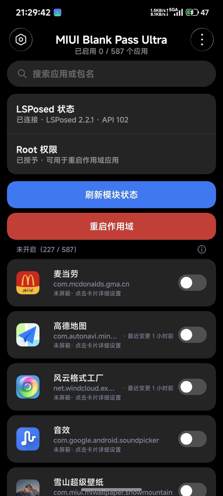
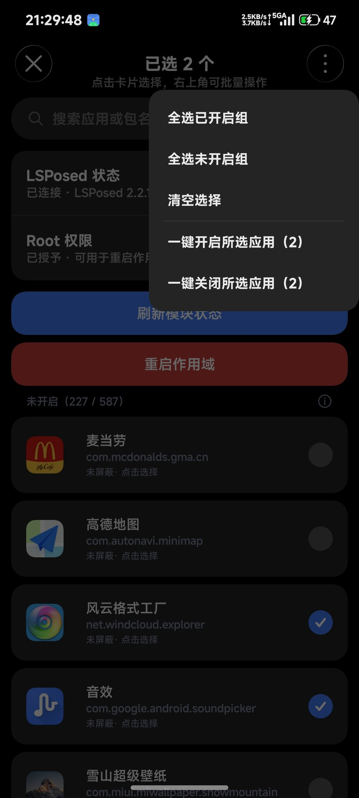
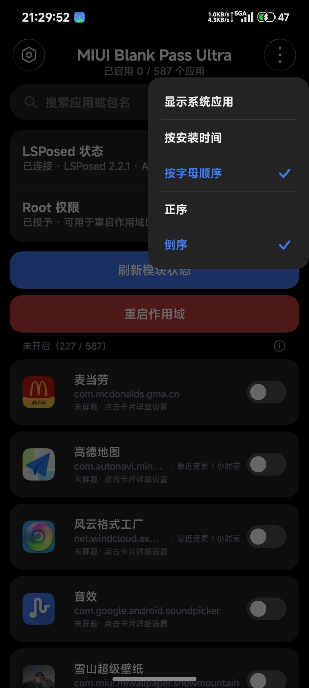
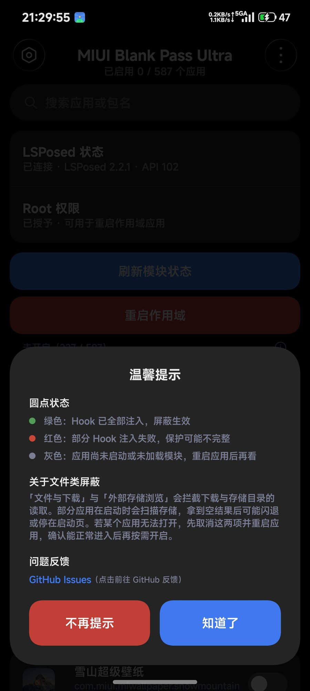
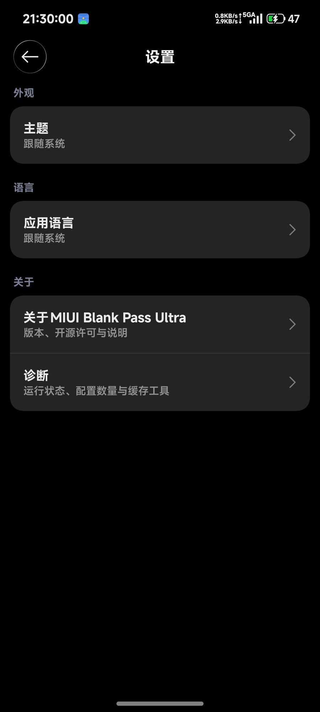
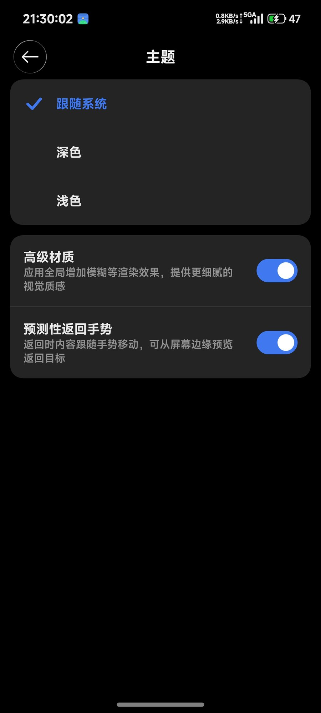
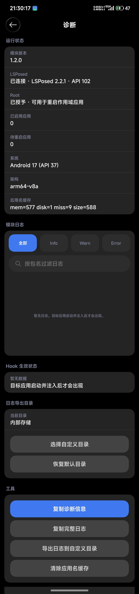
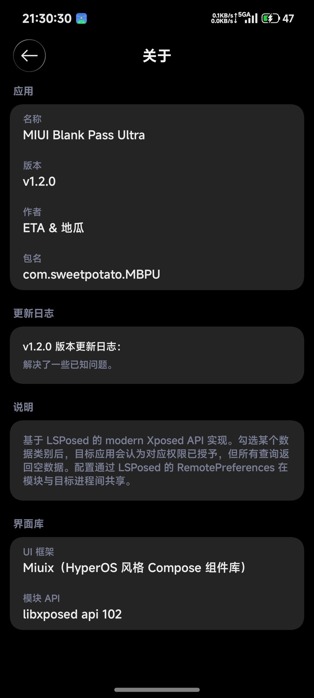

# MIUI Blank Pass Ultra（空值权限）

基于 LSPosed 的 modern Xposed API 模块：勾选的权限类别，目标应用会认为「已授权」，但所有查询都拿到空数据。

不是权限管理，也不是拒绝授权——是真授权、假数据。对应用来说权限状态一切正常，只是通讯录空了、相册空了、剪贴板空了、相机打不开了。

## 功能

| 类别 | 效果 |
| --- | --- |
| 通讯录 | 权限视为已授予，查询返回空列表 |
| 短信 | 权限视为已授予，查询返回空列表；发送与彩信下载被拦截并回报失败 |
| 通话记录 | 权限视为已授予，查询返回空列表 |
| 日历 | 权限视为已授予，查询返回空列表 |
| 相册媒体 | 媒体权限视为已授予，图片 / 视频 / 音频返回空 |
| 文件与下载 | 存储权限视为已授予，下载目录与文档查询返回空 |
| 外部存储浏览 | 应用列不出外部存储目录 |
| 定位 | 权限视为已授予，但返回空值且不再上报位置 |
| 剪贴板 | 读取剪贴板返回空 |
| 设备标识 | 电话状态权限视为已授予，IMEI / IMSI / 序列号返回空 |
| 应用列表 | 应用列表权限视为已授予，查询返回空 |
| 账户 | 账户权限视为已授予，系统账户列表返回空 |
| 麦克风 | 录音权限视为已授予，录到的数据全为零（静音） |
| 相机 | 相机权限视为已授予，但打开相机失败、不返回画面 |

界面部分：

- Miuix（HyperOS 风格 Compose 组件库）实现，深浅色跟随系统，支持高级材质（玻璃 / 模糊）
- 单应用精细开关 + 批量开启 / 关闭，自动向 LSPosed 申请作用域
- 每张卡片带 Hook 状态圆点：绿 = 全部注入，红 = 部分失败，灰 = 尚未注入；读不到模块日志时显示「状态未知」而不是误报「尚未注入」
- 诊断页：运行状态、配置数量、按包名 / 级别筛选模块日志、一键导出
- 20 种语言：简体中文、繁体中文（香港 / 台湾）、维吾尔语、藏语、英语（US / GB）、法语、德语、意大利语、土耳其语、荷兰语、俄语、西班牙语（ES / 拉美）、葡萄牙语（PT / BR）、阿拉伯语（RTL）、日语、韩语

## 截图

<table>
<tr>
<td></td>
<td></td>
<td></td>
<td></td>
</tr>
<tr>
<td align="center">主页</td>
<td align="center">批量选择</td>
<td align="center">排序与系统应用</td>
<td align="center">温馨提示</td>
</tr>
<tr>
<td></td>
<td></td>
<td></td>
<td></td>
</tr>
<tr>
<td align="center">设置</td>
<td align="center">主题与高级材质</td>
<td align="center">诊断</td>
<td align="center">关于</td>
</tr>
</table>

## 环境要求

- Android 10 及以上（minSdk 29，targetSdk 37）
- LSPosed（modern Xposed API，minApiVersion 101、targetApiVersion 102）
- Root 只在「重启作用域应用」和诊断页读取模块日志时需要，模块本体不需要

## 使用

1. 安装 APK
2. 在 LSPosed 里启用「MIUI Blank Pass Ultra」，勾选需要生效的应用
3. 打开模块，选中应用 → 勾选要屏蔽的类别（模块会自动写入作用域）
4. 强制停止并重新打开目标应用

关闭类别后 hook 不会立刻卸载，需要重启目标应用；卡片和批量操作里都会提示。

## 官方包指纹

官方发布的 APK 由固定证书签名，证书 SHA-256 为：

```
ebe065a95b248ca8e9d98a4f8e4a9e3877b30e1a3b61833e9a34cf41c29dc0d0
```

安装前可以自己核对拿到的包是不是这个证书签的：

```bash
apksigner verify --print-certs 你的包.apk
```

看输出里的 `Signer #1 certificate SHA-256 digest` 是否一致。不一致就是别人改过重签的版本，不要装。

## 已知限制

- 「文件与下载」「外部存储浏览」「相册媒体」是文件 / URI 级拦截。对已经拿到真实存储权限的应用，系统 fuse 层仍可能放行部分路径，屏蔽完整性不如系统级权限撤销
- 部分应用启动时会扫描存储，拿到空结果后可能闪退或停在启动页（应用内「温馨提示」有说明）
- `ContentProviderClient.call(String method, String arg, Bundle)` 这类拿不到 authority 的三参调用未拦截
- `MediaRecorder` 录音链路未 hook，只覆盖了 `AudioRecord`
- 不带 authority 的 `applyBatch`：全部命中屏蔽范围时返回伪成功；混合批次抛 `OperationApplicationException` 引导应用回滚
- 卸载应用后配置残留不会自动清理，重装同包名会继承旧配置

## 更新日志

### v1.5.0

1. UI焕新
2. 解决了一些已知问题。

## 免责声明

仅供学习与个人隐私保护使用，请勿用于规避应用的风控、付费或授权机制。使用本模块造成的一切后果由使用者自行承担。

## 许可证

[PolyForm Strict 1.0.0](LICENSE)

本项目采用 PolyForm Strict 1.0.0 许可证：允许个人学习、研究、业余爱好等非商业用途，禁止分发、修改及基于本项目创建衍生作品。商业使用请通过 a285865818@outlook.com 联系获取授权。

这不是 OSI 定义的开源许可证。

## 链接

- 源码仓库：https://github.com/a285865818-crypto/miui-blank-pass-ultra
- 问题反馈：https://github.com/a285865818-crypto/miui-blank-pass-ultra/issues

作者：ETA & 地瓜
